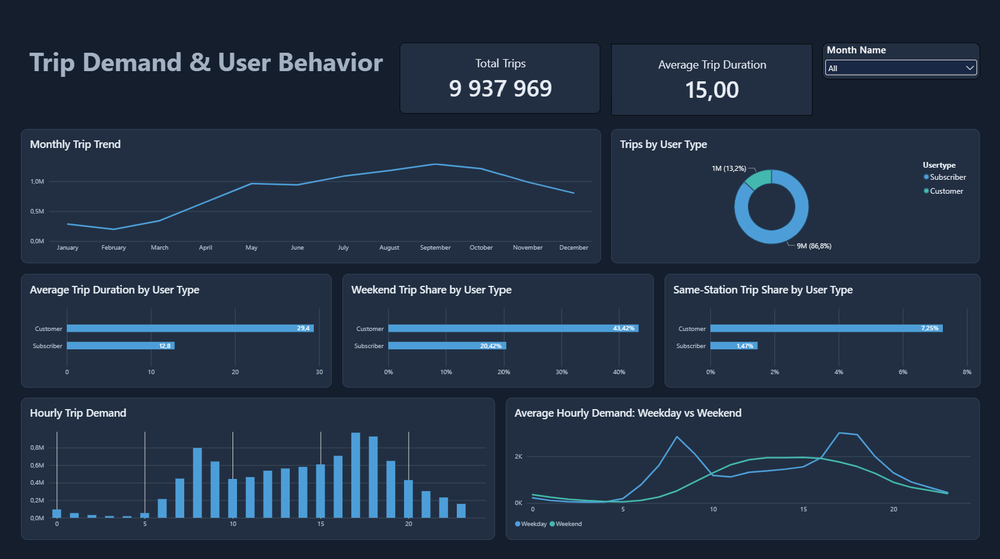
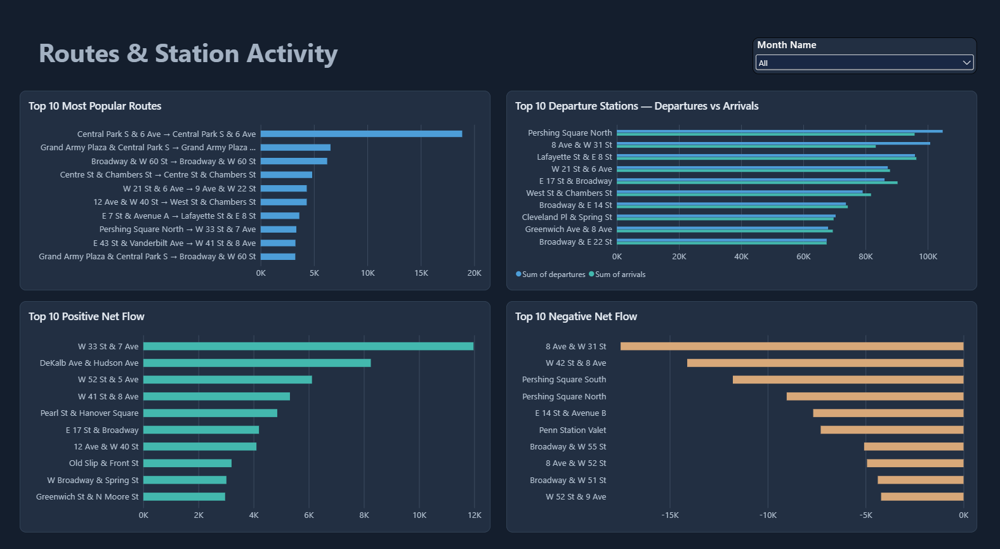

# NYC Citi Bike | 2015 Trip Analysis

**SQL · Google BigQuery · Power BI**

## Overview

This project explores approximately 9.94 million Citi Bike trips recorded in New York City in 2015, focusing on demand patterns, differences between customer types, and station activity.

I used Google BigQuery to validate and prepare the data, then built a two-page Power BI report to explore the results.

## Power BI Dashboard

### Trip Demand & User Behavior



Explores monthly and hourly demand, customer types, trip duration, and differences between weekday and weekend activity.

### Routes & Station Activity



Shows the most frequent station pairs, station departures and arrivals, and differences between incoming and outgoing trip volumes.

## Customer vs Subscriber: Usage Patterns

Subscribers accounted for 86.8% of all trips in 2015, while Customers represented 13.2%. I compared trip duration, weekend activity, and same-station trips to understand how usage differed between these groups.

| Metric | Customer | Subscriber |
|---|---:|---:|
| Average trip duration | 29.4 min | 12.8 min |
| Median trip duration | 20.5 min | 9.6 min |
| Weekend trip share | 43.42% | 20.42% |
| Same-station trip share | 7.25% | 1.47% |

*Trip duration metrics exclude trips longer than 24 hours.*

### What stood out

Customers took longer trips on average, but I also checked the median to see whether the difference was limited to unusually long rides. The median remained substantially higher for Customers.

Weekend trips accounted for 43.42% of Customer activity, compared with 20.42% for Subscribers. Customers were also nearly five times more likely to start and end a trip at the same station.

Together, these patterns suggest more leisure-oriented use among Customers and more routine travel among Subscribers. However, trip purpose is not recorded in the dataset, so this remains an interpretation rather than a confirmed fact.

## Other Findings

**Seasonal demand**

Trip volume varied considerably throughout the year. September recorded approximately 1.29 million trips, compared with about 197,000 in February. These are monthly totals and are not adjusted for the different number of days in each month.

**Weekday and weekend patterns**

Weekday demand showed peaks around 8 AM and 5–6 PM, while weekend activity was more concentrated during the daytime. To make the hourly comparison fair, weekday and weekend volumes were normalized by the number of days in each group.

**Station activity**

I compared station departures and arrivals using Net Flow (arrivals minus departures). This highlights stations where recorded incoming and outgoing trip volumes differ. It does not directly measure bike availability or prove that a station requires rebalancing.

## Data Preparation & Limitations

Data preparation and analysis were performed in Google BigQuery.

- Checked missing values, duplicate records, trip durations, and timestamp consistency.
- Created `clean_trips_2015` with additional date and time fields for analysis.
- Built `routes_2015` and `station_flow_2015` for route and station-level reporting.
- Retained unusually long trips in overall trip counts but excluded trips longer than 24 hours from duration comparisons.
- Used station IDs to identify stations and station pairs.

The prepared trip table retains flagged records rather than automatically removing every anomaly.

The dataset records trips, not unique riders. It does not establish why a trip was taken, and station-level trip flows do not represent real-time bike inventory.

## Repository Structure

```text
new_york_citibike/
├── README.md
├── sql/
│   ├── 01_data_preparation.sql
│   ├── 02_demand_patterns.sql
│   ├── 03_user_behavior.sql
│   └── 04_routes_and_stations.sql
├── dashboard/
│   └── CitiBike_2015_Design.pbix
└── images/
    ├── trip_demand.png
    └── station_activity.png
```
